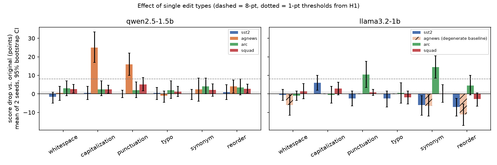
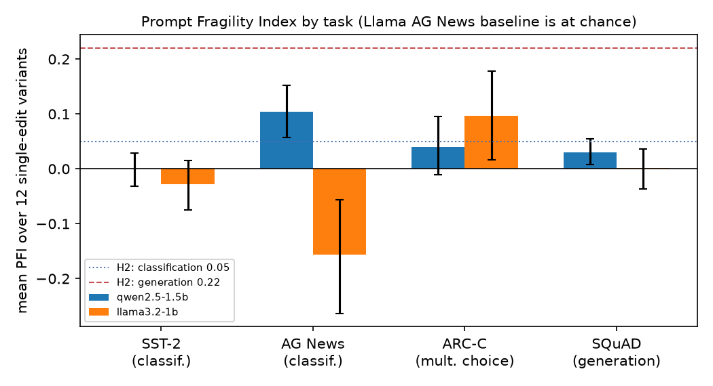
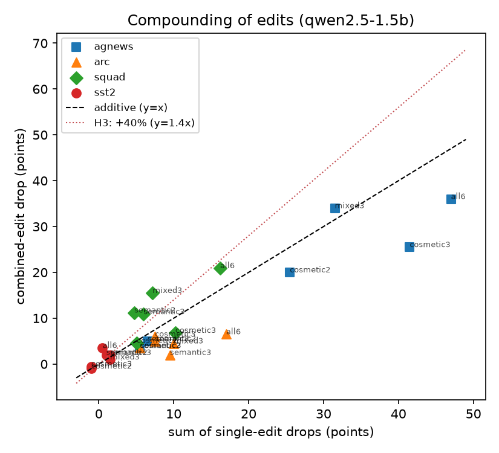

# The Prompt Fragility Index: Measuring How Small Edits Break LLM Performance

## 1. Executive Summary

**Question.** How much do small, meaning-preserving edits to an instruction prompt change LLM task performance? We tested six edit types: whitespace, capitalization, punctuation, typos, synonym substitution, and sentence reordering. We also asked whether the effect depends on task type and whether combined edits compound super-additively.

**Answer.** We tested two small open-weight instruction models (Qwen2.5-1.5B-Instruct and Llama-3.2-1B-Instruct) on four tasks, scoring 20,800 real model responses. **All three parts of the hypothesis were refuted as stated.**

1. No edit type is uniformly harmful or harmless. The damaging edit depends on the model-and-task pair:
   - For Qwen, *capitalization* (−25 points) and *punctuation* (−16 points) were by far the most damaging edits, but only on AG News.
   - For Qwen, *reorder* and *synonym* cost only about 2–4 points on every task.
   - For Llama, *synonym* (−14.5 points) and *punctuation* (−10.5 points) hurt ARC. Synonym and reorder edits *improved* its SST-2 accuracy.
   - Whitespace was the only edit type with a consistently small effect (|Δ| ≤ 3 points on every valid task).
2. Generation (SQuAD) was **not** the most fragile task type for single edits (mean PFI 0.03 and 0.00 for the two models, versus the predicted 0.22). The most fragile task was a 4-way classification task (Qwen AG News, PFI 0.10).
3. Compounding exceeded the additive prediction only for generation (Qwen SQuAD: combo/sum ratio 1.29–1.61). For classification and multiple-choice, combined edits were *sub*-additive (ratio 0.38–0.80) and broke fewer items than the union of their components. The cause is saturation: an item can only break once.

**Practical implications.**
- "Cosmetic" edits are not safe when they touch the parts of a prompt that define the answer space. Deleting the commas in a label list made Qwen treat "World Sports" as one label, and lowercasing shifted its label prior toward "sci/tech".
- Much of the apparent fragility in small models is **format** fragility. Edited prompts trigger preambles ("As a science teacher, I'd…") that a strict parser scores as wrong. With a 48-token budget and a lenient parser, Llama's ARC drops of 28–50 points shrank to 6–10 points or vanished.
- Net accuracy changes also hide churn: item flip rates are often several times larger than the net drop.

## 2. Research Question & Motivation

**Hypotheses tested** (from the task specification):
- **H1:** instruction reordering and synonym substitution cause the largest drops (>8% accuracy loss), while whitespace and capitalization changes have minimal effect (<1%).
- **H2:** fragility is task-dependent. Classification is most robust (mean PFI 0.05) and generation most fragile (mean PFI 0.22).
- **H3:** combining 3+ edit types gives compounding fragility that exceeds the sum of the individual effects by 30–50%.

**Why it matters.** Prompts are edited all the time (reformatting, rephrasing, merging instructions), and evaluation results are usually reported for a single prompt. If benign edits move accuracy by several points, single-prompt benchmarks are unreliable and prompt maintenance needs regression testing.

**Literature context.** The resource-gathering stage of this pipeline was skipped and the paper-search service returned no results, so this summary is from the author's knowledge and the papers were not re-read for this study.
- Sclar et al. (2024, *Quantifying Language Models' Sensitivity to Spurious Features in Prompt Design*, ICLR) showed that formatting choices alone can move few-shot accuracy by tens of points.
- Mizrahi et al. (2024, *State of What Art? A Call for Multi-Prompt LLM Evaluation*, TACL) showed that paraphrased instructions reorder model rankings.
- Zhu et al. (2023, *PromptBench*) studied adversarial character, word and sentence perturbations.
- Lu et al. (2022, *Fantastically Ordered Prompts*) studied few-shot example order.
- ProSA (Zhuo et al., 2024) and POSIX (Chatterjee et al., 2024) proposed prompt-sensitivity indices.

**Gap addressed here:**
- a controlled taxonomy of *benign*, human-editor-style edits (not adversarial attacks);
- the same edits applied across task *types*;
- a design that measures the **interaction (compounding) term** directly, because a combined edit contains the same local edits as its single-edit counterparts.

## 3. Experimental Setup

### 3.1 Compute constraints and the resulting deviations from the ideal design

- **No LLM API key was available.** `OPENROUTER_KEY` was unset, and the pipeline's `.env` entry was commented out. We therefore did **not** use GPT-4.1, Claude or Gemini. Instead we ran **real open-weight instruction-tuned LLMs locally** with llama.cpp. Every result below comes from actual model generations; nothing is simulated.
- **No GPU.** The host has 32 cores, but other jobs kept it at load average 33–65, and measured prefill throughput was only ≈40 tokens/s per server. This forced:
  - small models (1–1.5B parameters);
  - short-output tasks (GSM8K-style chain-of-thought generation was dropped);
  - n = 100 items per task.
- **Consequence:** results describe *small* models. Frontier models are likely much less fragile in absolute terms, so the magnitudes should not be extrapolated to them.

### 3.2 Models

| Model | File | Inference |
|---|---|---|
| Qwen2.5-1.5B-Instruct | `bartowski/Qwen2.5-1.5B-Instruct-GGUF`, Q8_0 | llama.cpp `llama-server` b11624 (CPU) |
| Llama-3.2-1B-Instruct | `bartowski/Llama-3.2-1B-Instruct-GGUF`, Q8_0 | same |

Decoding settings:
- greedy (temperature 0), `seed=42`, default chat template, single user turn;
- `max_tokens` = 4 (SST-2), 5 (AG News), 8 (ARC), 24 (SQuAD).

### 3.3 Tasks

| Task | Type | Metric | n | Prompt input |
|---|---|---|---|---|
| SST-2 (val.) | classification, 2-way | accuracy | 100 | `Review: …` |
| AG News (test) | classification, 4-way | accuracy | 100 | `Article: …` |
| ARC-Challenge (test) | multiple choice, 4 options | accuracy | 100 | `Question: …\nA. …` |
| SQuAD v1.1 (val., passages ≤110 words) | free-form short-answer generation | token F1 (EM also logged) | 100 | `Passage: …\n\nQuestion: …` |

Each prompt is a **4-sentence instruction**, then a separator (`\n\n`), then the task input. For example, the AG News instruction is:

> You are an expert news topic classifier. Read the news article provided below carefully. Decide which topic the article belongs to; the possible topics are World, Sports, Business, and Sci/Tech. Respond with only the topic name and nothing else.

All templates are in `src/tasks.py`.

Scoring:
- **Labels:** the earliest label mention in the output, matched case-insensitively.
- **ARC:** the leading option letter, otherwise the first standalone uppercase A–D.
- **SQuAD:** official-style normalized token F1 against the best of the gold answers.
- Unparseable outputs count as wrong (strict format scoring). Section 5.3 examines this choice.

### 3.4 Edits (`src/perturb.py`)

Edits apply **only to the instruction**, never to the task input. Label words are protected from synonym and typo edits.

| Edit | Operation |
|---|---|
| whitespace | 30% of spaces become 2–3 spaces or tabs; sentence joiners and the instruction/input separator become random spaces or newlines |
| capitalization | seed 0: everything lowercased; seed 1: 35% of words randomly upper-, lower-, title- or swap-cased |
| punctuation | each `. , : ; ! ?` deleted (p = 0.6) or swapped for another mark (p = 0.2) |
| typo | ~15% of words with ≥4 letters get an adjacent swap, a dropped or duplicated letter, or a keyboard-neighbor substitution |
| synonym | curated near-synonym lexicon, p = 0.6 per eligible word (e.g. "Choose the single best answer from the options" → "Pick the single most suitable answer among the choices") |
| reorder | a random non-identity permutation of the 4 instruction sentences |

Design details:
- **Seeds:** each edit type was run with 2 seeds (different random edits).
- **Combinations:** cosmetic2 (whitespace+capitalization), semantic2 (synonym+reorder), cosmetic3 (whitespace+capitalization+punctuation), semantic3 (synonym+reorder+typo), mixed3 (capitalization+synonym+reorder), and all6. Each was run at both seeds.
- **Compounding design:** randomness is keyed by (seed, edit type, sentence index), and reordering happens after word-level edits. A combo at seed *s* therefore contains the same local edits as the singles at seed *s*, except where operators touch the same word (for example, a typo landing on a substituted synonym).
- **Totals:** 26 conditions per task: the original, 12 singles, 12 combos, and a rerun of the original as a noise-floor control. 2 models × 4 tasks × 26 × 100 = **20,800 scored generations.**

### 3.5 Metrics and statistics

- **Δ (points)** = score(original) − score(edited), averaged over items. Positive means worse.
- **PFI** = Δ / score(original), the relative drop. We also report |PFI| because edits can help.
- **Flip rate** = the share of items whose correctness changes. For SQuAD, a flip means crossing F1 = 0.5.
- **Confidence intervals:** paired 95% bootstrap over items (10,000 resamples). For single edit types, the two seeds are averaged per item first.
- **Tests:** exact McNemar for binary tasks and Wilcoxon signed-rank for SQuAD F1, pooled over seeds, with Holm correction across 24 edit × task tests per model.
- **Compounding,** with two no-interaction baselines:
  - *Additive:* Σ Δ(singles), as in the hypothesis.
  - *Union:* the combo breaks an item iff any component breaks it (per-item minimum score). This is the natural baseline for bounded per-item scores, because additivity double-counts an item that several edits break.
  - The interaction is Δ(combo) − baseline, with an item-bootstrap CI.

### 3.6 Reproducibility and cost

- Runtime: about 2.3 hours of wall-clock time on up to 4 concurrent llama.cpp servers (6–8 threads each).
- Cost: zero API cost.
- Raw outputs, including every prompt and response, are in `results/raw/<model>/<task>.jsonl`.

## 4. Results

### 4.1 Baselines and noise floor

| | SST-2 | AG News | ARC-C | SQuAD F1 |
|---|---|---|---|---|
| Qwen2.5-1.5B original | 93.0 | 75.0 | 72.0 | 88.5 |
| Llama-3.2-1B original | 75.0 | **25.0** (chance) | 49.0 | 71.6 |
| Qwen rerun of identical prompt: flip rate | 2% | 0% | 1% | 0% |
| Llama rerun of identical prompt: flip rate | 1% | 0% | 0% | 0% |

- llama.cpp continuous batching is slightly nondeterministic. Identical prompts gave byte-identical outputs 95% of the time (212 accidental duplicate SQuAD requests for Llama) and changed correctness on 0–2% of items. **Flip rates of ≤2% are within noise.**
- **Llama AG News is degenerate:** it answers "World" for 98 of 100 items, the first label listed in the prompt. Relative PFI is meaningless at a chance-level baseline, so this cell is reported but excluded from pooled conclusions. This is a *post-hoc* exclusion, made after seeing the baseline.

### 4.2 H1: effect of each edit type

Δ in points, mean of 2 seeds, with 95% bootstrap CI. `*` marks Holm-adjusted p < 0.05; positive means worse.

**Qwen2.5-1.5B-Instruct**

| edit | SST-2 | AG News | ARC-C | SQuAD (F1) |
|:--|:--|:--|:--|:--|
| whitespace | −1.5 [−5.0, +1.0] | +0.5 [−3.5, +4.0] | +3.0 [−1.0, +7.0] | +2.6 [+0.6, +5.0] |
| capitalization | +0.5 [−3.0, +4.0] | **+25.0 [+17.0, +33.5]*** | +2.5 [−1.0, +7.0] | +2.4 [+0.3, +4.7] |
| punctuation | +0.0 [−2.0, +2.0] | **+16.0 [+10.0, +22.0]*** | +2.0 [−2.0, +6.5] | +5.2 [+1.7, +8.7] |
| typo | +0.5 [−3.0, +3.5] | −1.0 [−4.5, +1.5] | +2.0 [−2.5, +7.0] | +1.2 [−1.5, +4.0] |
| synonym | +0.0 [−3.0, +2.5] | +2.5 [−4.0, +8.5] | +4.0 [+0.0, +8.5] | +2.1 [−1.2, +5.5] |
| reorder | +1.0 [−3.0, +5.0] | +4.0 [+0.5, +7.5] | +3.5 [−0.5, +8.0] | +2.7 [+0.5, +5.2] |

**Llama-3.2-1B-Instruct** (AG News column is the degenerate baseline)

| edit | SST-2 | AG News† | ARC-C | SQuAD (F1) |
|:--|:--|:--|:--|:--|
| whitespace | −0.5 [−3.5, +2.5] | −6.0 [−11.5, −0.5] | −1.0 [−3.5, +1.5] | +1.5 [−2.6, +5.5] |
| capitalization | +6.0 [+2.0, +10.0] | 0.0 | −0.5 [−5.0, +4.0] | +2.9 [−0.5, +6.3] |
| punctuation | −2.5 [−6.5, +1.5] | 0.0 | +10.5 [+3.5, +17.5] | +0.8 [−0.8, +2.4] |
| typo | −2.5 [−7.0, +1.5] | 0.0 | +0.5 [−5.0, +6.0] | −1.8 [−5.4, +1.6] |
| synonym | −6.0 [−11.5, −1.0] | −6.5 [−12.0, −0.5] | **+14.5 [+8.5, +20.5]*** | +0.2 [−4.6, +4.9] |
| reorder | **−7.0 [−12.0, −2.5]*** | **−11.0 [−17.0, −5.5]*** | +4.5 [−0.5, +10.0] | −2.8 [−6.6, +0.6] |

**Pooled over valid tasks** (`results/h1_edit_types.csv`; mean Δ in points, with the largest single-task Δ in parentheses):

| edit | Qwen | Llama (excl. AG News) | Verdict on H1 |
|---|---|---|---|
| whitespace | 1.2 (max 3.0) | 0.0 (max 1.5) | ≈ supported ("minimal"), though the SQuAD CI is above the 1-point threshold for Qwen |
| capitalization | **7.6 (max 25.0)** | 2.8 (max 6.0) | **refuted** (not <1%) |
| punctuation | 5.8 (max 16.0) | 2.9 (max 10.5) | not part of H1; large on some tasks |
| typo | 0.7 (max 2.0) | −1.3 (max 0.5) | robust |
| synonym | 2.1 (max 4.0) | 2.9 (max 14.5) | **refuted** for Qwen (never >8); supported only for Llama on ARC, which is a format effect (§5.3) |
| reorder | 2.8 (max 4.0) | −1.8 (max 4.5) | **refuted** (never >8 points; it *helped* Llama on SST-2 and AG News) |

The flip rate for an edit type ranged from 2–8% on robust cells up to 32% (Qwen AG News capitalization) and 25.5% (Llama ARC punctuation). Flip rates were often several times the net |Δ|, because edits fix some items while breaking others (`figures/flip_vs_delta.png`, `figures/heatmap_flip_*.png`).

### 4.3 H2: fragility by task type

Mean PFI over the 12 single-edit variants per task (`results/task_pfi_*.csv`), with item-bootstrap 95% CI:

| Task (type) | Qwen PFI | Llama PFI |
|---|---|---|
| SST-2 (classification) | 0.001 [−0.03, 0.03] | −0.028 [−0.07, 0.02] (mean \|PFI\| over conditions 0.086) |
| AG News (classification) | **0.104 [0.06, 0.15]** | (degenerate) |
| ARC-C (multiple choice) | 0.039 [−0.01, 0.09] | **0.097 [0.02, 0.18]** |
| SQuAD (generation) | 0.031 [0.01, 0.05] | 0.002 [−0.04, 0.04] |
| *Classification mean (H2: 0.05)* | 0.053 | −0.028 |
| *Generation (H2: 0.22)* | 0.031 | 0.002 |

The classification mean for Qwen matches the predicted 0.05 numerically, but only as the average of a near-zero SST-2 and a fragile AG News. Generation is **far below** the predicted 0.22 and is not the most fragile type for either model. **H2 is refuted.**

When combos are included (all 24 perturbed conditions), Qwen SQuAD rises to 0.081 [0.05, 0.11] because of its super-additive compounding (§4.4). It is still below AG News (0.190).

### 4.4 H3: compounding

Pooled over all combos of a given size and both seeds (`results/compounding_pooled_*.csv`). Values are Δ in points; the interaction CIs are item-bootstrap CIs.

**Qwen2.5-1.5B**

| task | k | Δ combo | additive null | ratio combo/additive | interaction vs. additive | union null | interaction vs. union |
|---|---|---|---|---|---|---|---|
| SST-2 | 3 | 0.8 | 0.7 | (≈0/0) | +0.2 [−4.7, 5.7] | 4.0 | −3.2 [−6.7, −0.5] |
| AG News | 3 | 21.0 | 26.2 | **0.80** | −5.2 [−12.2, 1.7] | 27.7 | −6.7 [−11.0, −2.3] |
| AG News | 6 | 36.0 | 47.0 | 0.77 | −11.0 [−28.5, 6.5] | 43.0 | −7.0 [−14.5, 0.5] |
| ARC-C | 3 | 4.2 | 9.0 | **0.46** | −4.8 [−13.2, 3.2] | 7.5 | −3.3 [−6.8, −0.2] |
| ARC-C | 6 | 6.5 | 17.0 | 0.38 | −10.5 [−30.0, 8.0] | 9.5 | −3.0 [−8.0, 1.5] |
| SQuAD | 2 | 7.9 | 4.9 | **1.61** | +3.0 [0.3, 5.9] | 5.5 | +2.4 [−0.4, 5.1] |
| SQuAD | 3 | 11.1 | 7.8 | **1.42** | +3.3 [−2.2, 8.2] | 7.7 | +3.3 [−0.6, 7.2] |
| SQuAD | 6 | 20.9 | 16.2 | **1.29** | +4.7 [−6.5, 15.0] | 10.7 | **+10.2 [4.3, 16.3]** |

**Llama-3.2-1B:** the additive ratios are unstable because the singles' Δ have mixed signs; for example, the SST-2 sum of singles is negative. Against the union null, the interaction was negative in 5 of the 6 SST-2/SQuAD task × k cells, with all 5 CIs below 0 (the exception is SST-2 all6: +4.0 [−4.5, 12.5]). It was also negative in all three cells of the degenerate AG News task. For ARC it was −3.8, −2.7 and −11.5 for k = 2, 3 and 6. A few individual ARC combos were strongly super-additive: semantic3@0 lost 48 points versus 33 for the sum of its parts, and mixed3@0 lost 40 versus 26. This is because a reordered persona sentence combined with synonyms triggered "As a science teacher, I'd…" preambles (§5.3).

**Verdict on H3:**
- Only Qwen SQuAD (generation) matches the hypothesized +30–50% compounding: ratios 1.42 for k = 3 and 1.29 for k = 6.
- Even there, the k = 3 interaction CI includes 0 against both nulls. Only the all-six combo is clearly super-additive against the union null.
- For classification and multiple-choice, compounding is sub-additive. **H3 is supported only for generation in one model, and is otherwise refuted.**

### 4.5 Edit magnitude

Character-level edit distance between the original and edited instruction correlates with the flip rate for both models (Spearman ρ = 0.46 and 0.51, p < 1e-5, n = 96 conditions). It correlates with the net drop only for Qwen (ρ = 0.44; Llama ρ = 0.02). Larger edits cause more churn but not reliably more net damage.

## 5. Analysis & Discussion

### 5.1 Why do "cosmetic" edits sometimes break classification?

Qwen AG News, predicted-label counts out of 100 (`results/error_analysis_qwen2.5-1.5b.md`):

| condition | Business | World | Sports | Sci/Tech |
|---|---|---|---|---|
| original | 42 | 26 | 21 | 11 |
| capitalization@0 (lowercase) | 29 | 12 | 12 | **46** |
| capitalization@1 (random case) | 42 | **4** | 42 (e.g. "SPOrts") | 10 |
| punctuation@0 (commas removed) | 23 | **55** + 10 "World Sports" | 3 | 9 |

These edits change the **answer-space specification**, not the task wording. Removing the commas in "World, Sports, Business, and Sci/Tech" makes "World Sports" look like one category. Re-casing the label words changes which label tokens the model prefers. The model's mistakes are therefore content errors (accuracy among parsed outputs falls from 75% to 50–60%), not format errors. SST-2's two labels ("positive or negative") survive the same edits unharmed. **Fragility follows the size and delimitation of the label set more than the edit category.** A taxonomy that calls capitalization and punctuation "cosmetic" misses this.

### 5.2 Why is generation not the most fragile?

For single edits, the SQuAD instruction is redundant ("short span copied directly from the passage" plus "only the answer span, without any explanation"), so one edit rarely removes the constraint. Under the semantic, mixed3 and all6 combos, Qwen's mean answer length grows from 3.0 to 4.8–7.3 words (EM 0.77 → 0.40–0.61), and it answers in full sentences:

> 'John Myhill' → 'John Myhill provided a definition of linear bounded automata in 1960.'

Each edit weakens the format constraint a little, and only together do they cross the point where the model abandons span-style answers. That is a plausible mechanism for the super-additivity seen only on generation. Classification answers, by contrast, are bounded: once an item is wrong it cannot get "more wrong", so effects saturate and appear sub-additive.

### 5.3 Format fragility versus content fragility, and a robustness check

The table below shows Llama ARC under strict scoring, for selected edit types:

| | original | synonym | punctuation | semantic3 | mixed3 |
|---|---|---|---|---|---|
| parse failures | 4% | 32% | 2% | 48% | 44% |
| accuracy among parsed outputs | 51% | **51%** | 39% | 38% | 37% |

- The synonym drop is entirely a format effect. "Pick the single most suitable answer" makes the model echo that phrase as a preamble, which the 8-token budget cuts off.
- The punctuation drop is a genuine content effect.

To check how much is truncation, we re-ran four Llama ARC conditions with `max_tokens = 48` and a lenient extractor ("answer is X", "option X", a leading letter, and so on). See `src/robustness_maxtokens.py` and `results/robustness_maxtokens_llama3.2-1b_arc.jsonl`.

| condition | main run (8 tokens, strict) | 48 tokens, lenient | unparsed at 48 tokens |
|---|---|---|---|
| original | 49 | 50 | 3% |
| synonym@0 | 21 | 44 | 18% |
| semantic3@0 | 1 | 40 | 16% |
| mixed3@0 | 9 | 52 | 6% |

With a generous budget, most of the catastrophic drops disappear. A residual 6–10-point drop remains for synonym and semantic3, partly from answers still not given within 48 tokens. So "fragility" is partly a property of the **evaluation protocol** (strict and short versus lenient and long), and PFI values should always be reported with the parser and budget used. The main tables use strict short-budget scoring, which matches how the prompt instructs the model to answer ("only the letter"), but this choice inflates format-driven PFI for weaker instruction followers.

An earlier configuration of our own was flawed in the same way. ARC with `max_tokens = 3` produced 14% parse failures even for the *original* prompt, because outputs like "The correct answer…" were cut off. We discarded that run (kept in `results/raw/arc_maxtok3_discarded.jsonl`) and re-ran ARC with 8 tokens before analysis.

### 5.4 Edits can help

Several edits significantly *improved* accuracy:
- Llama SST-2: reorder +7 points, synonym +6.
- Llama AG News: reorder +11 from the degenerate baseline, because reordering moved "World" away from the first-listed position, which broke the first-label collapse.

The original wording is not privileged; it is just one sample from a distribution of equivalent prompts, in line with the multi-prompt-evaluation argument of Mizrahi et al. Reporting signed PFI averages can hide this, which is why we also report flip rates and |PFI|.

### 5.5 Summary against the hypothesis

| Claim | Result |
|---|---|
| Reorder and synonym edits cause >8% drops | **Refuted.** Reorder never exceeded 4.5 points; synonym exceeded 8 points only in Llama ARC, and that was mostly a format/truncation effect |
| Whitespace and capitalization edits cause <1% drops | **Half-refuted.** Whitespace is small (≤3 points, ≈1 on average); capitalization reached 25 points (Qwen AG News) and 6 points (Llama SST-2) |
| Classification PFI ≈ 0.05 < generation PFI ≈ 0.22 | **Refuted.** Generation PFI was 0.00–0.03; classification ranged from 0.00 to 0.10 depending on the label set |
| 3+ edits compound by +30–50% | **Only for generation (Qwen SQuAD, ratio 1.29–1.42;** CI includes 0 at k = 3). Classification and multiple-choice were sub-additive (ratio 0.4–0.8) |

## 6. Limitations

- **Small models only,** with no API models (no key was available). Fragility is known to decrease with scale and instruction tuning, so the absolute magnitudes here are upper-range values for frontier models.
- **n = 100 items per task and 2 seeds per edit type.** A 4–5-point effect is often within the CI, and only 5 of 48 edit × task cells survive Holm correction (4 excluding the degenerate Llama AG News cell). More seeds (different random edits) would better separate "edit type" from "this particular edit".
- **One instruction template per task.** Template-specific features, such as the comma-delimited label list or the persona sentence, drive several effects. With other base prompts, the ranking of edit types could differ. Indeed, our results suggest the ranking depends on prompt structure more than edit category.
- **Strict short-budget scoring** inflates format-driven fragility (§5.3). We quantified this for Llama ARC only.
- **Nondeterminism:** llama.cpp batching changed outputs for about 5% of identical requests (0–2% correctness flips). Effects of ≤2 points are within noise.
- **The Llama AG News baseline is at chance,** so it was excluded post hoc.
- **Task-type confound:** each task type has only one or two tasks, so differences between task types are confounded with dataset, label-set size and baseline accuracy (SQuAD's F1 metric is also continuous rather than binary).
- **Synonym lexicon and typo rates** are researcher-chosen. "Meaning preservation" was checked by inspection, not by human raters. A few substitutions are slightly ungrammatical (e.g. "an specialist").
- **Quantization:** both models ran at Q8_0, which is near-lossless but not bit-identical to bf16.

## 7. Conclusions & Next Steps

**Answer.** For small instruction-tuned LLMs, a single benign prompt edit typically moves task scores by 0–5 points, but particular edit × task combinations move them by 10–25 points. The damaging edit is **not** a fixed edit type, as the hypothesis claimed. Instead:

- edits that alter the **answer-space specification** (label-list punctuation and casing) break classification;
- edits that weaken the **output-format constraint** break strict-format multiple-choice and, when compounded, generation.

Generation was not the most fragile task type, and super-additive compounding appeared only for generation.

**Implications:**
1. Treat label lists and output-format instructions as "load-bearing" parts of a prompt and regression-test any edit to them.
2. Report prompt-sensitivity metrics together with the parser and token budget used, plus flip rates rather than only net Δ.
3. Evaluate with several equivalent prompts, because some edits *improve* the score.

**Follow-ups:**
- Repeat with frontier API models (GPT-4.1, Claude, Gemini) once a key is available. The code only needs `--port` swapped for an OpenRouter base URL.
- Use multiple base templates per task to separate edit type from template structure.
- Run more seeds per edit type.
- Add a lenient or LLM-judge scorer alongside strict scoring for every condition.
- Add longer-form generation (summarization, chain-of-thought math) to test whether generation-specific super-additivity grows with output length.
- Run a targeted experiment that edits only the label list versus only the task description, to confirm the answer-space mechanism.

## References

- Sclar, M., Choi, Y., Tsvetkov, Y., Suhr, A. (2024). Quantifying Language Models' Sensitivity to Spurious Features in Prompt Design. ICLR.
- Mizrahi, M., Kaplan, G., Malkin, D., Dror, R., Shahaf, D., Stanovsky, G. (2024). State of What Art? A Call for Multi-Prompt LLM Evaluation. TACL.
- Zhu, K. et al. (2023). PromptBench: Towards Evaluating the Robustness of Large Language Models on Adversarial Prompts. arXiv:2306.04528.
- Lu, Y., Bartolo, M., Moore, A., Riedel, S., Stenetorp, P. (2022). Fantastically Ordered Prompts and Where to Find Them. ACL.
- Zhuo, J. et al. (2024). ProSA: Assessing and Understanding the Prompt Sensitivity of LLMs. Findings of EMNLP.
- Chatterjee, A. et al. (2024). POSIX: A Prompt Sensitivity Index for Large Language Models. Findings of EMNLP.
- Datasets: SST-2 (Socher et al., 2013), AG News (Zhang et al., 2015), ARC (Clark et al., 2018), SQuAD v1.1 (Rajpurkar et al., 2016).
- Models: Qwen2.5 (Qwen Team, 2024); Llama 3.2 (Meta, 2024). Tools: llama.cpp (ggml-org), HuggingFace `datasets`, SciPy, statsmodels.

(Citations are from the author's knowledge; the literature-search stage of this pipeline did not run, so the bibliographic details were not re-verified.)
